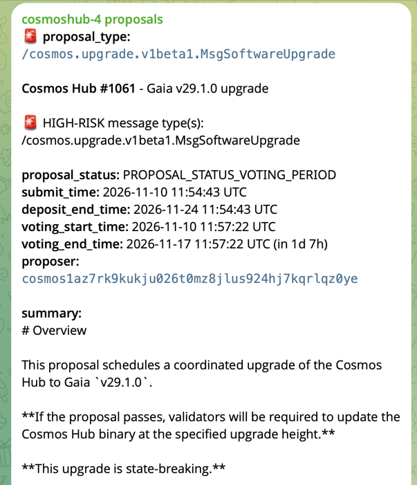

## Setup

### 1. Create the Telegram bot and channel

1. In Telegram, open **@BotFather**, send `/newbot`, and follow the prompts. Copy the **bot token**. It looks like `123456789:AA...`
2. Create channel, or use an existing one. Public or private both work
3. Add the bot to the channel as an **administrator** with the **Post messages** permission
4. Get the **chat id**:
    - For a public channel, use `@your_channel_name`
    - For a private channel, post any message in the channel,
      then open `https://api.telegram.org/bot<TOKEN>/getUpdates` in a browser and find `"chat":{"id":-100...}`.

### 2. Test locally (optional but recommended)

```bash
# Dry run: fetches live data and prints the messages. No Telegram needed
DRY_RUN=1 python3 proposal_tracker.py

# Unit tests
python3 -m unittest discover -s tests -v

# Real post to your channel
cp .env.example .env        # then edit .env
set -a && source .env && set +a
python3 proposal_tracker.py
```

### 3. Add the secrets in GitHub

Go to **Settings → Secrets and variables → Actions → New repository secret** and add:

| Secret               | Value                        |
|----------------------|------------------------------|
| `TELEGRAM_BOT_TOKEN` | the token from BotFather     |
| `TELEGRAM_CHAT_ID`   | `-100...` or `@channel_name` |

Optional **Variables** go on the **Variables** tab:

| Variable                | Default                                                        |
|-------------------------|----------------------------------------------------------------|
| `COSMOS_REST_ENDPOINTS` | the built-in list above                                        |
| `REPORT_STATUSES`       | `PROPOSAL_STATUS_VOTING_PERIOD,PROPOSAL_STATUS_DEPOSIT_PERIOD` |
| `NOTIFY_ON_FAILOVER`    | `true`                                                         |


### 4. Run it once by hand

Go to the **Actions** tab, select **Cosmos Hub proposal tracker**,
and click **Run workflow**.
Can tick *dry_run* to see the output only in the log. After that it runs every day on its own.


